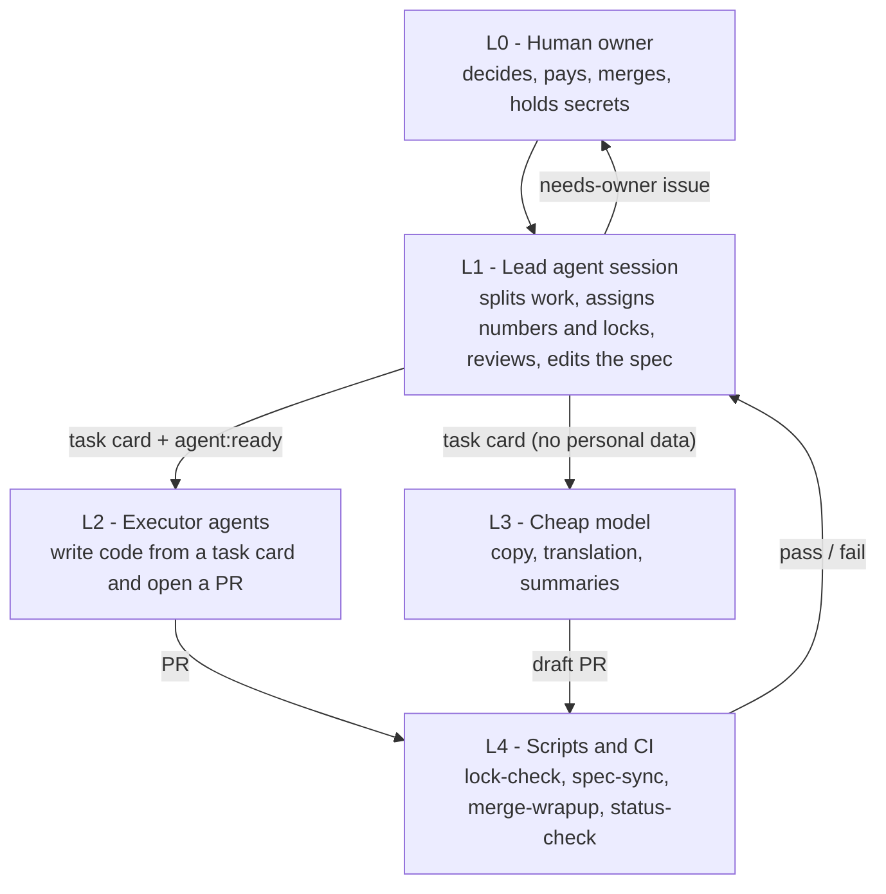

# Layered AI Dev Workflow

A way to run several AI coding-agent sessions on one repository at the same time, with task cards, file locks, a number
ledger and handoff notes, plus the small Node scripts that enforce the rules in CI.

## The problem

When more than one agent session works on a repo in parallel, three things go wrong:

- **Context has to be repeated.** Every new session starts from nothing, so the same background is explained again.
- **Numbers collide.** Spec versions and migration numbers are picked by whoever is fastest. In the project this comes
  from, three PRs took the same spec version on one day.
- **Quota runs out.** Each turn re-reads the whole conversation, so long sessions and expensive models burn through the
  budget on work a cheaper layer could have done.

## The approach

Split the work into layers and use the lowest layer that can do each step. State lives on GitHub (task cards, PRs, the
ledger), never in a conversation.



The rules an agent must follow every turn are short (`template/CLAUDE.md`). Anything only one role needs is a skill.
Anything a program can check becomes CI, and the prose rule is deleted.

## Quick start

1. Copy the template into your repository:
   `cp -r template/. /path/to/your-repo/` (this brings `CLAUDE.md`, `AGENTS.md`, the skills, the issue template,
   `.agents/ledger.md` and an example `spec-sync.yml`).
2. Copy the checks: `scripts/`, `workflow.config.json`, `package.json` (or merge its `test` script) and
   `.github/workflows/{ci,lock-check,merge-wrapup}.yml`.
3. Edit `workflow.config.json` (time zone, labels, which files count as code) and replace the `<PLACEHOLDERS>` in
   `CLAUDE.md` and `AGENTS.md` (`<SPEC_DOC>`, `<TODO_DOC>`, `<PROJECT_NAME>`).
4. Open your first task card from the "Task card" issue template, fill in "Files and docs to change" (the file lock),
   add a row for it in `.agents/ledger.md`, then add the label `agent:ready`.
5. Run `npm test` (Node 20 or newer, no packages to install). Push a branch and open a PR with `Closes #<card>`:
   `lock-check` will compare the changed files with the card's lock.

## Case numbers

As of 2026-10-27, for 2026-10-24 to 2026-10-27. Source: GitHub statistics of the private repo of the project this came from.
Details and caveats are in [docs/case-study.md](docs/case-study.md).

| Measure | Value |
| --- | --- |
| Pull requests opened / merged | 135 / 130 |
| Issues opened / closed | 84 / 55 |
| Merged PRs from agent-run branches (`agent/<card>`) | 30 |
| Docs PRs merged automatically | 5 |
| GitHub Actions workflows / `.mjs` scripts / test files | 17 / 20 / 34 |
| L1 sessions chained by ledger numbers and handoff notes | S-001 to S-016 |
| L2/L3 calls in the usage log / cheap-model calls and their cost | 30 / 10 calls, about US$0.03 |
| `CLAUDE.md` size after moving L1-only rules into skills | about 39% smaller |
| Spec versions | main spec v1.61, collaboration spec v1.16 |

## Repository layout

```
README.md                 this page
docs/architecture.md      layers, task card lifecycle, handoff, ledger, data boundary, cost
docs/case-study.md        the project this came from: problem, approach, results
docs/stack.md             appendix: the technology stack of that project (text only)
template/                 copy into your repo: CLAUDE.md, AGENTS.md, skills, sub-agent,
                          issue template, ledger, spec-sync example
examples/                 a de-identified task card, handoff notes, a ledger excerpt
scripts/                  lock-check, check-spec-sync, merge-wrapup, status-check (+ scripts/lib)
tests/                    node:test tests for the scripts (fake data, no network)
.github/workflows/        ci, lock-check, merge-wrapup
workflow.config.json      settings the scripts read (labels, time zone, headings, file patterns)
```

Not included from the original project: the delegation script that calls a cheap model, usage-cost reporting, the
to-do-list sync that reads a Google Doc, and anything specific to that project's website. The status check in
this repo compares the ledger with GitHub only; the original also compared a to-do document.

## Acknowledgements

Built at TechStarterWeb Consulting (techstarterweb.com). Thanks to Co-founder Ivan (Fu Lap Hang) at TechStarterWeb
Consulting. Author: Yu-Chen Chao.

## License

MIT, see [LICENSE](LICENSE).
