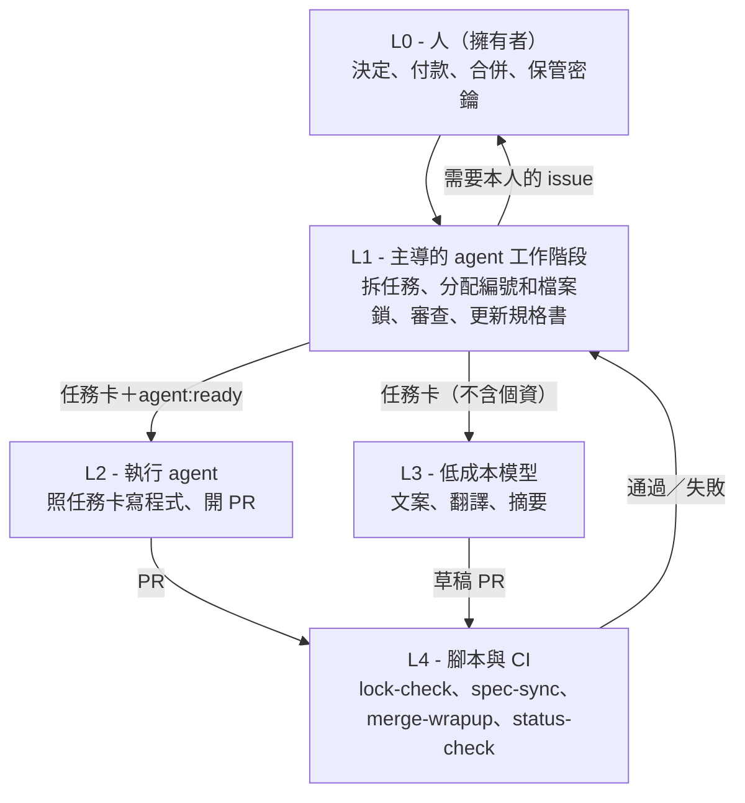

# Layered AI Dev Workflow（分層 AI 開發流程）

[English](README.md)

讓多個 AI coding agent 工作階段同時在同一個 repository 工作的方法：任務卡、檔案鎖、編號資源表（ledger）和交接紀錄，加上幾支在 CI 裡執行這些規則的小型 Node 腳本。

## 要解決的問題

多個 agent 工作階段平行處理同一個 repo 時，會出現三個問題：

- **背景要一再重講。** 每個新的工作階段都從零開始，同樣的背景要重新說明。
- **編號撞號。** 規格書版本、migration 編號由先動手的人挑。在這套方法的來源專案裡，曾有三個 PR 在同一天用了同一個規格書版本。
- **額度用完。** 每一輪都要重讀整段對話，長的工作階段和昂貴的模型，會把額度花在下層就能做的事上。

## 做法

把工作分層，每一步都用做得到的最低一層。狀態放在 GitHub（任務卡、PR、ledger），不放在對話裡。



agent 每一輪都要遵守的規則寫得很短（`template/CLAUDE.md`）。只有某個角色用得到的細節寫成技能（skill）。能用程式檢查的規則寫成 CI，寫好就把文字規則刪掉。

## 快速開始

1. 把範本複製到你的 repository：
   `cp -r template/. /path/to/your-repo/`（會帶進 `CLAUDE.md`、`AGENTS.md`、技能、issue 模板、`.agents/ledger.md` 和一個 `spec-sync.yml` 範例）。
2. 複製檢查程式：`scripts/`、`workflow.config.json`、`package.json`（或只合併它的 `test` 指令），以及 `.github/workflows/{ci,lock-check,merge-wrapup}.yml`。
3. 修改 `workflow.config.json`（時區、label、哪些檔案算程式碼），並替換 `CLAUDE.md`、`AGENTS.md` 裡的 `<PLACEHOLDERS>`（`<SPEC_DOC>`、`<TODO_DOC>`、`<PROJECT_NAME>`）。
4. 用「Task card」issue 模板開第一張任務卡，填好「Files and docs to change」（也就是檔案鎖），在 `.agents/ledger.md` 加一列，再加上 label `agent:ready`。
5. 執行 `npm test`（Node 20 以上，不用安裝套件）。推一個分支、開 PR，說明裡寫 `Closes #<卡號>`：`lock-check` 會把改到的檔案和任務卡的檔案鎖比對。

## 案例數字

截至 2026-10-27，期間為 2026-10-24 至 2026-10-27。來源：來源專案私人 repo 的 GitHub 統計。細節和注意事項見 [docs/case-study.md](docs/case-study.md)。

| 項目 | 數值 |
| --- | --- |
| 開出／合併的 pull request | 135／130 |
| 開出／關閉的 issue | 84／55 |
| 來自 agent 自動執行分支（`agent/<卡號>`）的合併 PR | 30 |
| 自動合併的文件 PR | 5 |
| GitHub Actions workflow／`.mjs` 腳本／測試檔 | 17／20／34 |
| 以 ledger 編號和交接紀錄串接的 L1 工作階段 | S-001 至 S-016 |
| 用量紀錄中的 L2／L3 呼叫次數／低成本模型呼叫次數與費用 | 30／10 次，約 US$0.03 |
| 把 L1 專用規則移到技能後的 `CLAUDE.md` 大小 | 約少 39% |
| 規格書版本 | 主規格書 v1.61、協作規格書 v1.16 |

## Repository 結構

```
README.md                 英文說明
README.zh-TW.md           這一頁
docs/architecture.md      分層、任務卡生命週期、交接、ledger、資料界線、成本
docs/case-study.md        來源專案：問題、做法、成果
docs/stack.md             附錄：來源專案的技術棧（只有文字）
template/                 複製到你的 repo：CLAUDE.md、AGENTS.md、技能、子代理、
                          issue 模板、ledger、spec-sync 範例
examples/                 去識別化的任務卡、交接紀錄、ledger 節錄
scripts/                  lock-check、check-spec-sync、merge-wrapup、status-check（＋scripts/lib）
tests/                    腳本的 node:test 測試（假資料、不連網）
.github/workflows/        ci、lock-check、merge-wrapup
workflow.config.json      腳本讀取的設定（label、時區、標題、檔案規則）
```

沒有從來源專案搬過來的：呼叫低成本模型的委派腳本、用量費用報表、從 Google 文件同步待辦清單的程式，以及所有只屬於該專案網站的東西。這裡的狀態核對只比對 ledger 和 GitHub；原版還會比對待辦文件。

## 致謝

在 TechStarterWeb Consulting（techstarterweb.com）建立。感謝 TechStarterWeb Consulting 共同創辦人 Ivan（Fu Lap Hang）。作者：Yu-Chen Chao。

## 授權

MIT，見 [LICENSE](LICENSE)。
