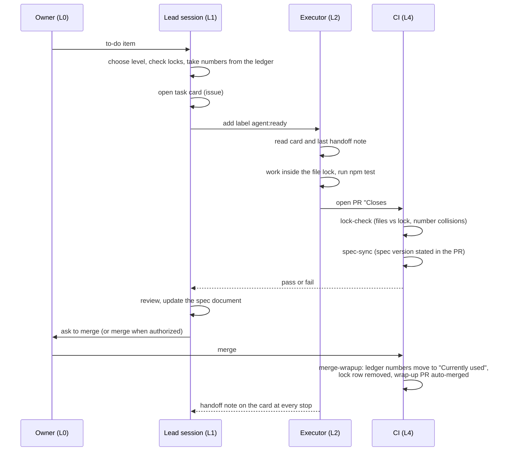

# Architecture

## Layers

| Layer | Who | Does | Does not |
| --- | --- | --- | --- |
| L0 | Human owner | Decides direction, answers multiple-choice questions, pays, sets passwords and secrets, merges when it matters | Write task cards or numbers by hand |
| L1 | Lead agent session (the strongest model) | Splits work into task cards, assigns numbers and file locks, reviews PRs, edits the spec document, writes handoff notes, claims `S-NNN` | Write code that L2 can write; read large files itself |
| L2 | Executor agent (mid-size model), or a read-only explorer (small model) | Works from one task card inside its file lock, runs tests, opens a PR; the explorer reads and summarizes | Merge, edit the spec, push to `main`, touch files outside the lock |
| L3 | Cheap model | Copy, translation, summaries, rough patches for L2 to apply | See customer personal data, prices, secrets |
| L4 | Scripts and CI | Rules that a program can check: file locks, number collisions, spec sync, ledger wrap-up after merge, consistency reports | Judge anything that needs reading comprehension |

**Use a lower layer whenever it can do the job.** Before starting, decide which layer each step belongs to: judgement,
decomposition and the spec go to L1; code goes to L2; text work goes to L3; checks go to L4; payments, passwords and
merging go to the owner. L1 does not do work that L2 or L3 could do; it writes the card and hands it over. A task that
looks like L1 work is split further so that part of it can drop a layer.

Exception, to avoid paying more for the process than for the work: L1 may do a change directly when opening, handing
over and reviewing a card would cost more than the change, and it says so in its report. It applies only to (1) docs,
rules, the ledger and skill text, and (2) code changes of at most 2 files and 20 lines with no new logic.

## Task card lifecycle

A task card is a GitHub issue made from the issue template. Its fields: to-do number, goal, background links, execution
level, **files and docs to change** (this is the file lock), pre-assigned numbers, acceptance criteria, do-not list,
limits.

The same flow as a list: to-do item, task card, label `agent:ready`, execution, PR, CI (`lock-check`, `spec-sync`,
tests), merge, `merge-wrapup`. If a card's files collide with another open card, it queues (no `agent:ready` yet).

## Handoff notes

Conversation is not state. When a session stops (work done, or quota or max-turns nearly used up), it leaves a comment on
the task card with four parts, and the next session, from any account, reads the card and the **last** note:

1. **Done** - what was done, with commits and PRs.
2. **Current state** - branch, CI result, where unfinished work stopped.
3. **Next** - the first thing the next person does.
4. **Needs a person** - things only the owner can do. They are kept in one pinned "needs owner" issue, each with a
   self-contained instruction a web agent can follow.

L1 notes also carry the session number and the approximate number of turns; a fifth line, "practices worth capturing",
collects ways of working that should become a skill or script the second time they appear. See
`template/.claude/skills/handoff/SKILL.md` and `examples/handoff.md`.

## The ledger

`.agents/ledger.md` is one Markdown file that only L1 edits. It has four parts:

- **Numbers**: one row per resource (spec versions, migrations). "Currently used" is on `main`; "Assigned (unmerged)" is
  given to a card or PR that has not merged. The next free number comes after both. CI rejects the same number twice in
  one "Assigned" cell, and an assigned number that is also "used".
- **Session numbers**: each L1 session claims `S-NNN` when it starts. Notes and instructions carry it, so sessions can be
  chained and traced. CI rejects duplicates.
- **Spec write lock**: only the holder may edit the spec document.
- **Active cards and file locks**: open cards labelled `agent:ready` or `agent:running`, and the files each one locks.
  The card's own field is the source of truth; `scripts/status-check.mjs --locks` prints what is locked.

After a merge, `merge-wrapup` moves the numbers and removes the lock row by itself and opens a wrap-up PR from a `bot/`
branch (which is skipped by the workflow, so it cannot trigger itself).

## Data boundary

Customer personal data (names, emails, phone numbers, original requests, uploaded material), prices and quotes, secrets
and access settings are never sent to L3 or any external model. A task that needs them goes to L2, or is de-identified by
a script first. Task cards must not contain them either. Secrets live in the platform's secret store, not in code.

## Cost control

- Use the lowest layer that works; the strongest model is for decomposition, the spec and architecture decisions.
- Each turn re-reads the whole conversation, so cost is about context length times turns. End a session when a batch is
  done or after one compaction, leave a handoff note, and start the next batch fresh.
- Hand large reading to an explorer sub-agent or a cheap summary; L1 verifies and decides.
- Do not switch models in the middle of a long conversation (the cache is lost); switch between tasks.
- Write multi-step operations as one script. Put independent tool calls in one turn.
- Subscribe only to PRs that need watching; check docs-only PRs together on a timer.
- Keep the always-read rule file short. In the source project, moving L1-only rules into skills shrank `CLAUDE.md` by
  about 39%, and L2 runs stopped re-reading them every turn.

## Rules become CI

A rule that can be checked by a program does not stay as prose. File locks, number collisions, the spec-sync statement
and the ledger wrap-up were rules in `CLAUDE.md` first. Once the check existed (`lock-check`, `check-spec-sync`,
`merge-wrapup`), the paragraph was deleted and replaced with "CI blocks this". What stays in the rule file is only what
needs judgement or is needed on every turn. A rule only one role needs goes into a skill. If the same handling appears a
second time, it becomes a skill or a script.
