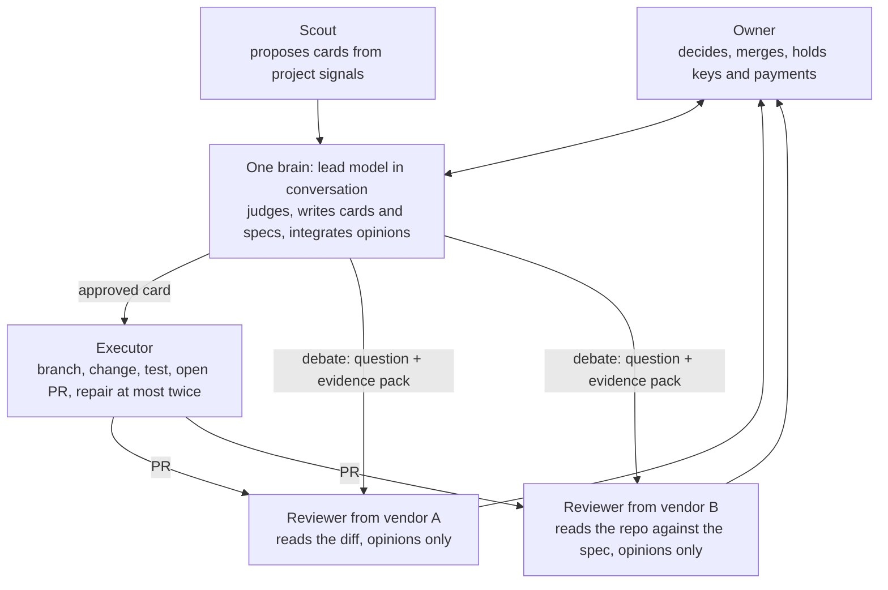

# v2 (2026-11): from one repository to a personal multi-project setup

Version 1 (the rest of this repository) ran several agent sessions on **one** code repository during a four-day burst
of work. A month later the same person was running AI agents on several unrelated projects at once: a website, a small
desktop tool, a data project, and two projects that are only documents and decisions (no code). This page describes what
had to change, why, and what did not work. It describes the method only; no project data is included.

## What went wrong with v1 at this scale

- **A burst, then a stop.** After the intense sprint the owner did not want to touch the agents for more than a week.
  A setup that only works while someone pushes it hard is not a setup.
- **One reviewer has one set of blind spots.** All judgement and all review came from models of one vendor.
- **Work done in conversation left queued work behind.** The owner finished something in an interactive session, while
  task cards and pull requests for the same thing stayed in the queue, failed, and kept asking to be retried.
- **Most projects were not code.** Planning work has decisions, sources and documents, not pull requests. Task cards and
  CI did not fit them.
- **Manual setup steps failed in front of the owner.** A setup script for keys and notifications was changed seven times
  and re-run by the owner six times, because it had never been tested in the owner's actual shell.

## What changed

### 1. One brain, two reviewers from different vendors

Only one model has the owner's context (memory, decision log); it judges, writes the cards and the specs. Two models from
two other vendors review every pull request before the owner merges, and only give opinions. When they disagree, the
summary says so. The idea is that models from different vendors miss different things. Nobody but the owner merges.

### 2. Decisions are debated with evidence

For decisions about money, architecture, anything irreversible, or anything that goes into a spec, the lead model first
builds an **evidence pack**: numbered items `[E1]`, `[E2]`… with source, the relevant text, and a grade (A: peer-reviewed or
official primary source; B: working paper or professional body; C: news, blogs, forums, a lead only). Evidence **for and
against** is collected. Both reviewers get the question and the pack (they have no web access) and answer independently.
Every claim must cite an item; a claim without one is marked **[no evidence]** and cannot support a conclusion. The
conclusion separates "verified" from "inferred", and warns about anchoring when the question contains the lead model's
own position. In practice the reviewers overturned the lead model's proposal several times; that is the point.
Method: [evidence-debate.md](evidence-debate.md). Templates: `template-lite/docs/debates/_template/`.

Scale matters: small choices get a source link, not a debate. Each debate costs the owner attention to read the result.

### 3. A local loop with guardrails, instead of GitHub-driven automation

A local service runs a **scout** (reads project health and outside changes, proposes task cards) and an **executor**
(works a card on a branch, runs tests, opens a PR). Guardrails:

- The owner approves cards, or turns on an autopilot that only approves low-risk cards on listed safe paths.
- The executor may run only allow-listed commands; during autopilot anything else is refused and logged for later,
  instead of waking the owner.
- A file lock per card, as in v1; changing files outside it blocks the push.
- A failed card is repaired automatically at most twice, then handed to the owner.
- Quota gates: work starts only while usage is under a threshold.
- One report when the owner returns: what happened, what it cost, and a short list of one-click decisions.

### 4. Two project levels, and a way to close projects

Every new project starts at **level one: rules only** — a folder, local git, a short `AGENTS.md`, `CLAUDE.md` that imports
it, and a `SPEC.md`. Work happens in conversation; important decisions are debated. A project moves to **level two:
automation** (scout, executor, reviewers) only when it has a remote, an automated test command, a direction that has been
stable for two weeks, no personal data, and repetitive maintenance worth handing off. Projects are also **paused or
retired** with a checklist, so nothing keeps running or asking after the owner has moved on.
SOP: [project-sop.md](project-sop.md). Templates: `template-lite/`.

### 5. Stale-work hygiene

- When the lead model finishes something in conversation, it also closes the related cards and the executor's PRs, with
  the evidence. It never closes PRs that a person opened.
- A card whose base branch no longer exists is not retried; it is listed once for the lead model to check.
- The scout's backlog limit counts downstream work too (open PRs, failed and blocked cards), so a jammed project stops
  getting new cards.
- The owner merges quickly, so anything open for more than three days is checked by the lead model and closed if it has
  been superseded. Nothing is closed by age alone.
- Similar problems are grouped into one line in the report instead of one question each.

### 6. Short rule files, and rules from failures

- Rule files stay short and project-specific; general rules live once in a global file. A 2026 study found that
  repository-level context files did not raise, and sometimes lowered, coding agents' task success while raising cost by
  more than 20%, and recommended writing only minimal requirements (Gloaguen et al., *Evaluating AGENTS.md*, ICLR 2026,
  arXiv:2602.11988).
- When an executor fails, a cheap model writes a one-line lesson that later cards in the same project carry (at most
  eight per project). This was still an experiment when this page was written.
- The failed setup script produced a standing rule: before any step the owner must do by hand (keys, accounts, local
  scheduled tasks), test the whole path in the owner's real shell with fake values, including paste, empty input,
  timeouts and error responses; collect long keys through a git-ignored file, not hidden input; at most two owner actions
  at a time; after two failures at the same step, switch to the fallback or stop.

## What did not work, or is still open

- **Building faster than measuring.** In one week the owner made dozens of architecture decisions; experiments overlapped,
  which made it hard to tell which change helped. The fix was a fixed review date and "one change at a time, measured".
- **The system created its own chores.** Debates, confirmations and stale cards all took owner attention. The stale-work
  rules above came from this.
- **Automating subscription tools has terms-of-service risk.** Wrapping interactive tools and accounts in automation can
  run into usage limits or account restrictions. Core projects must keep working without this setup.
- **The real test is leaving it alone.** The intended acceptance test is a week without touching it: nothing rots, the
  report takes minutes, and the non-code projects still get useful output. At the time of writing that test had not
  been run.

## What carried over from v1

Task cards with file locks, handoff notes, "use the lowest layer that can do the job", short rule files with details in
skills, and turning checkable rules into CI. v1's scripts and `template/` are unchanged and still fit a single code
repository with several sessions.
